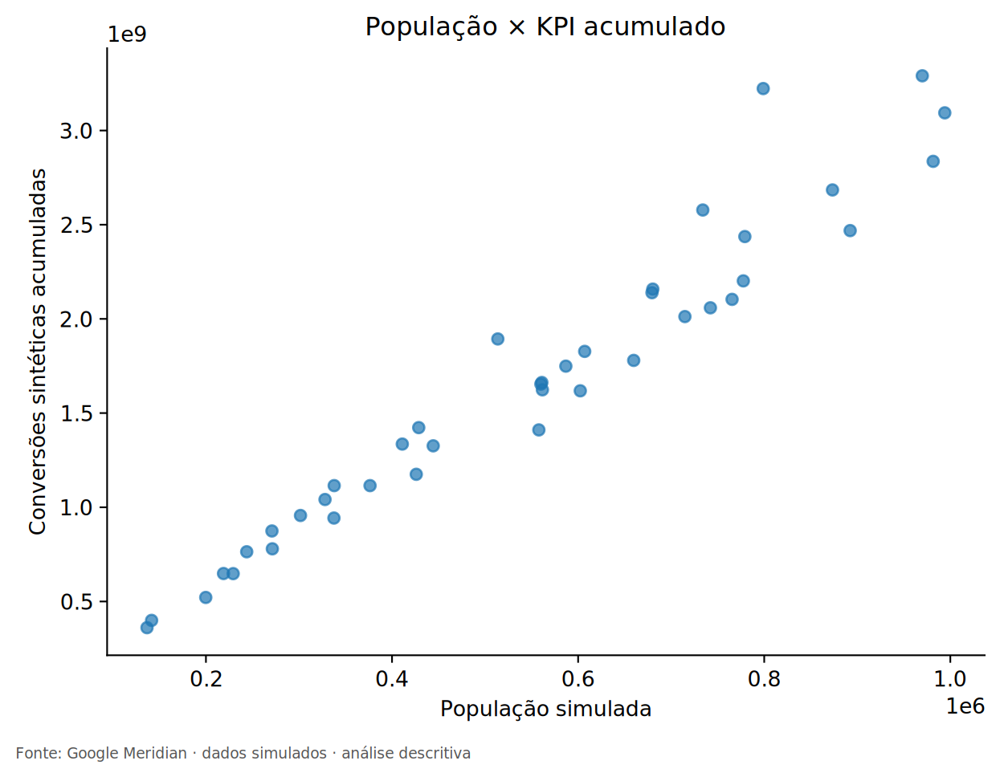
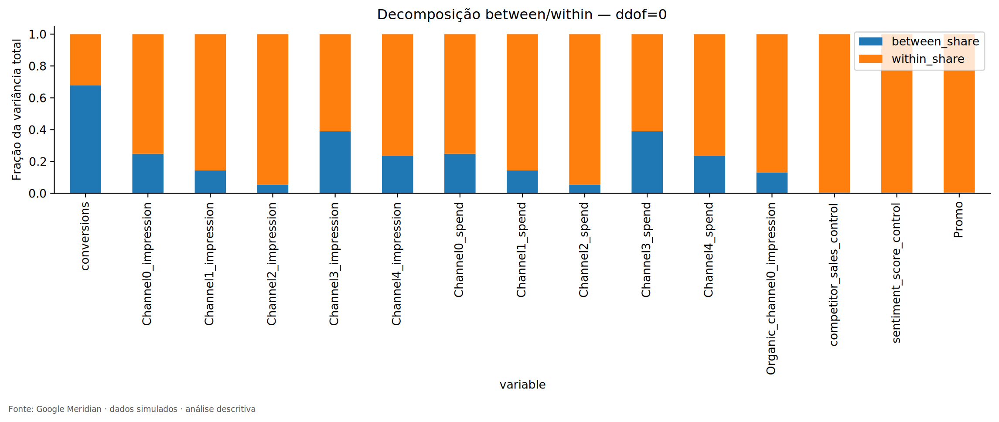
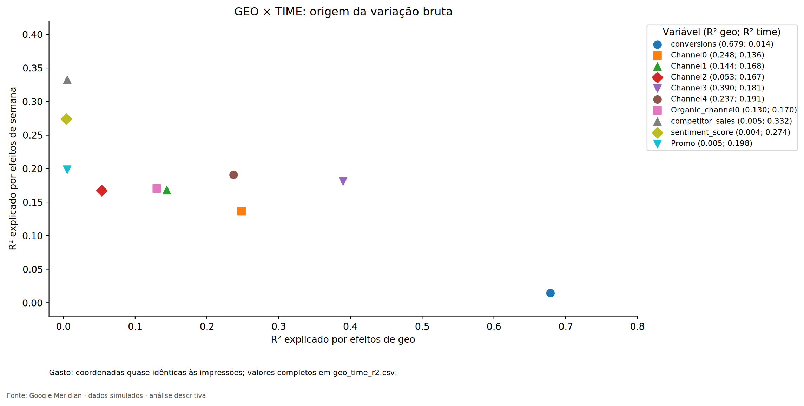
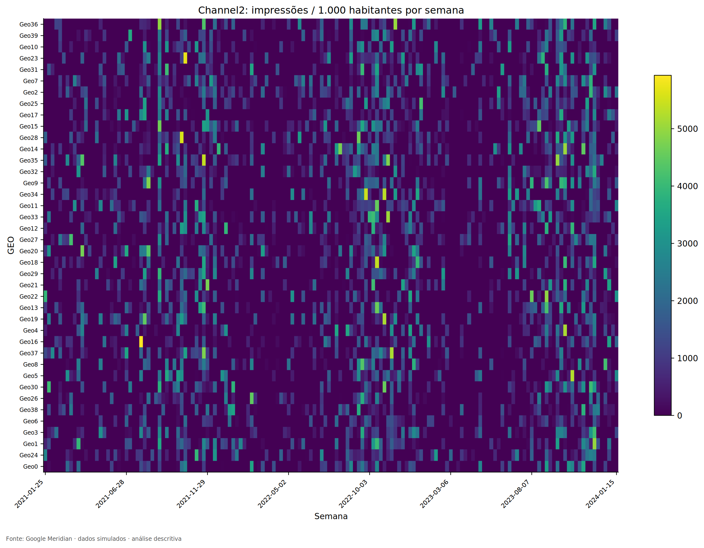
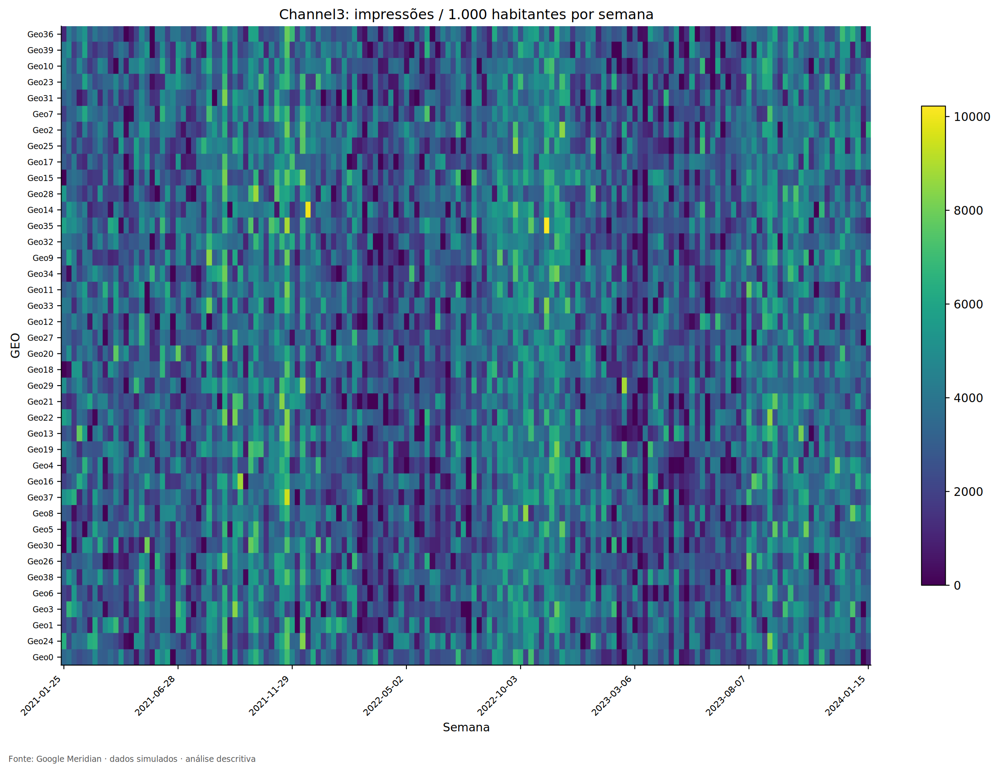
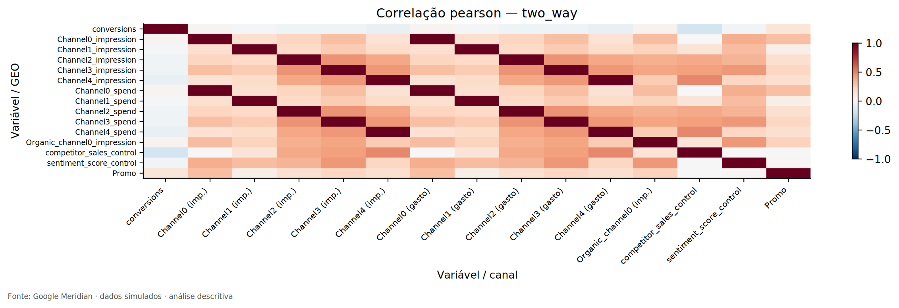
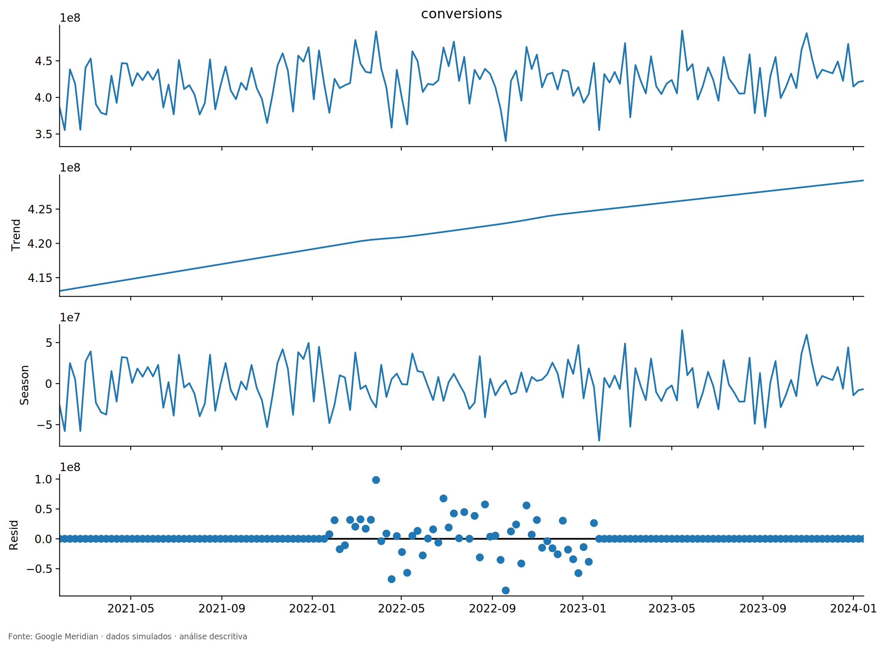

# 4 RESULTADOS DA ANÁLISE EXPLORATÓRIA DOS DADOS

## 4.1 Integridade dos registros e comportamento nacional

A auditoria confirmou 6.240 combinações únicas de mercado e semana, sem valores ausentes ou duplicações de chave (Tabela 1). A população permaneceu constante em cada mercado, e as verificações de consistência entre impressões e gastos dos canais pagos não identificaram combinações positivas incompatíveis. Esses resultados permitem estudar a heterogeneidade espacial sem introduzir imputação de períodos faltantes; contudo, não garantem que cada observação seja economicamente plausível ou causalmente informativa.

A soma semanal das conversões apresentou média próxima de **422,6 milhões**, mínimo de aproximadamente **340,3 milhões** em 19 de setembro de 2022 e máximo próximo de **491,3 milhões** em 15 de maio de 2023. A diferença entre extremos e as oscilações de curto prazo mostram que há variabilidade temporal, embora a série nacional não revele como os movimentos se distribuem entre mercados. A decomposição STL registrou crescimento aproximado de **3,90%** entre os extremos da componente suavizada de tendência; essa variação não corresponde a uma taxa de crescimento observada diretamente do primeiro ao último registro.

## 4.2 Heterogeneidade geográfica e influência da população

A distribuição das conversões evidencia diferenças importantes de nível entre os mercados. A decomposição da variância de `conversions` registrou **67,89%** da variação total entre mercados e **32,11%** dentro dos mercados ao longo das semanas. A correlação de postos entre população e conversões acumuladas foi de aproximadamente **0,978**; a correlação linear de Pearson ficou próxima de **0,97**, indicando forte associação dos volumes à escala populacional. Essa relação aparece na Figura 1 e recomenda cautela ao interpretar um mercado com muitas conversões como relativamente mais produtivo.

**Figura 1 – Associação entre população e conversões acumuladas nos mercados sintéticos**

Fonte: elaboração própria.

Nota: figura original preservada do notebook; cada ponto representa um mercado sintético. A relação é descritiva e não evidencia produtividade, demanda causal ou efetividade publicitária.

A mesma decomposição aplicada às exposições dos canais pagos mostra que suas distribuições são distintas: a parcela *within* vai de **61,01%** em `Channel3` a **94,65%** em `Channel2`. A Figura 2 reproduz a decomposição para as principais variáveis. Seu interesse científico reside em mostrar que grande variação dentro dos mercados pode coexistir com diferentes graus de heterogeneidade permanente; a decomposição, isoladamente, não informa se a variação tem conteúdo causal.

**Figura 2 – Decomposição da variância bruta entre e dentro dos mercados**

Fonte: elaboração própria.

Nota: as parcelas se referem à variância bruta de cada variável, com pesos iguais por observação.

## 4.3 A informação geotemporal e a mudança de escala

Além da decomposição *between/within*, a EDA retirou as médias de mercado e de semana para verificar quanto da dispersão permanecia fora dessas duas componentes aditivas. Como mostra a Figura 3, o KPI e os canais de mídia apresentam estruturas diferentes de variação geográfica e temporal. Para `conversions`, a parcela descritiva associada apenas à semana foi de **1,43%**, enquanto a parcela associada ao mercado foi de **67,89%**. A correlação temporal mediana entre as séries de conversões dos **780 pares de mercados** foi de **0,028**, com máximo de **0,280** e mínimo de **−0,215**; isso indica baixa sincronização linear contemporânea, mas não independência estatística.

**Figura 3 – Contribuição descritiva das médias de mercado e semana para a variância bruta**

Fonte: elaboração própria.

Nota: o gráfico expressa decomposições descritivas de variação bruta, não métricas de ajuste ou validação externa do MMM.

A Tabela 2 aprofunda a comparação entre escalas e consolida valores **efetivamente presentes nas tabelas de decomposição do notebook**. No caso de `Channel3`, a parcela de variância associada à média de mercado cai de **38,99%** na escala bruta para **0,49%** quando as exposições são expressas por mil habitantes. O mesmo movimento aparece nos demais canais, com participações geográficas inferiores a 0,6% na escala relativa. Contudo, após retirar efeitos aditivos de mercado e semana, persistem parcelas residuais de aproximadamente **64,85% a 79,28%** da variância das exposições por mil habitantes. Tais resíduos podem incluir movimentos locais, ruído, fatores não medidos e variações multiplicativas, não devendo ser equiparados a informação causal identificável.

**Tabela 2 – Decomposição da variação geográfica e geotemporal em duas escalas**

| Variável | Entre mercados, bruta (%) | Dentro dos mercados, bruta (%) | Resíduo GEO/TIME, bruto (%) | Entre mercados, por mil hab. (%) | Resíduo GEO/TIME, por mil hab. (%) |
|:--|--:|--:|--:|--:|--:|
| `conversions` | 67,89 | 32,11 | 30,68 | 9,10 | 86,11 |
| `Channel0` | 24,84 | 75,16 | 61,53 | 0,59 | 78,28 |
| `Channel1` | 14,41 | 85,59 | 68,80 | 0,44 | 76,52 |
| `Channel2` | 5,35 | 94,65 | 77,94 | 0,43 | 79,28 |
| `Channel3` | 38,99 | 61,01 | 42,90 | 0,49 | 64,85 |
| `Channel4` | 23,72 | 76,28 | 57,20 | 0,42 | 70,58 |

Fonte: elaboração própria.

Nota: para os canais, os indicadores se referem às impressões. Percentuais arredondados das saídas da EDA. As parcelas residuais não são contribuições incrementais da mídia e não se somam às parcelas *within* como categorias independentes.

Os resultados oferecem justificativa objetiva para investigar um modelo GEO: o painel preserva diferenças de atividade no tempo e entre mercados que não podem ser reconstruídas a partir dos totais nacionais. Eles não demonstram, entretanto, que a estimação GEO será necessariamente superior; esse resultado dependerá dos experimentos previstos nas Seções 3.6 e 3.7.

## 4.4 Composição dos investimentos e atividade dos canais

O orçamento acumulado dos mercados apresenta proporções relativamente semelhantes entre canais. `Channel3` responde por **40,03%** dos gastos pagos e mantém participação entre **38,00% e 41,36%** do orçamento individual dos mercados. `Channel2` corresponde a **5,50%** dos gastos, com participação por mercado de **4,04% a 6,46%**. Logo, o diferencial geográfico identificado não deve ser atribuído à existência de mixes acumulados radicalmente diferentes. É mais relevante examinar a distribuição das exposições no calendário de cada mercado.

**Tabela 3 – Gasto, ausência de exposição e continuidade de atividade por canal pago**

| Canal | Participação no gasto (%) | Observações sem exposição (%) | Maior sequência local sem mídia (semanas) | Variância *within* ligada a zero/positivo (%) |
|:--|--:|--:|--:|--:|
| `Channel0` | 18,45 | 12,10 | 4 | 25,33 |
| `Channel1` | 14,27 | 27,92 | 7 | 37,76 |
| `Channel2` | 5,50 | 64,26 | 27 | 50,48 |
| `Channel3` | 40,03 | 2,71 | 2 | 10,50 |
| `Channel4` | 21,75 | 13,14 | 4 | 27,48 |

Fonte: elaboração própria.

Nota: cada observação é uma combinação mercado–semana; participação de gasto e proporção de zeros possuem denominadores distintos. A última coluna expressa a contribuição da alternância de atividade para a variância dentro dos mercados, e não para a variância do KPI.

`Channel2` apresentou **4.010 células sem exposição em 6.240**, totalizando **64,26%** do painel, apesar de haver registros positivos em todos os mercados ao longo do período. O canal esteve ativo em 152 das 156 semanas nacionais; portanto, apenas quatro semanas tiveram exposição nacional igual a zero, enquanto as ausências locais foram muito mais frequentes. A maior sequência sem mídia em um mercado atingiu **27 semanas**. O contraste entre uma série nacional majoritariamente positiva e numerosos zeros locais constitui uma evidência de informação que a agregação temporal nacional oculta.

**Figura 4 – Calendário geotemporal de exposições do Channel2 por mil habitantes**

Fonte: elaboração própria.

Nota: cada linha corresponde a um mercado e cada coluna a uma semana; a escala de cor é específica desta figura.

O padrão de `Channel3` foi distinto: **169 das 6.240 células** estavam zeradas, equivalentes a **2,71%**. A maior sequência local de semanas ativas alcançou **127 semanas**, e a parcela da variância *within* associada à alternância zero/positivo foi de apenas **10,50%**. A Figura 5 ilustra essa atividade quase contínua. A diferença entre os canais não implica maior ou menor retorno de nenhum deles. Para a modelagem, sugere avaliar se `Channel2` contém períodos informativos suficientes nas máscaras de treinamento e teste e se a contribuição atribuída a `Channel3` é sensível a controles e componentes de base temporal.

**Figura 5 – Calendário geotemporal de exposições do Channel3 por mil habitantes**

Fonte: elaboração própria.

Nota: as escalas de cores das Figuras 4 e 5 diferem. A comparação direta adequada envolve frequência de zeros, continuidade e padrões temporais, não igualdade de cores entre painéis.

## 4.5 Associação entre canais, controles e conversões

As correlações variam conforme o nível de agregação e a transformação das observações. Para `Channel3`, a correlação entre impressões e conversões é de aproximadamente **0,47 no painel bruto**, reduz-se para cerca de **−0,05** quando são removidas as médias geográficas, permanece próxima de **−0,046** após a remoção adicional das médias semanais e é aproximadamente **−0,12** no total nacional semanal. Esses valores são registrados na interpretação do notebook e não devem ser lidos como mudanças no efeito causal do canal. Indicam que correlações entre níveis absolutos, desvios internos e agregados nacionais respondem a perguntas diferentes.

A associação entre os próprios canais também muda. A correlação de Pearson entre exposições de `Channel2` e `Channel3` foi de **0,700** no agregado nacional, **0,524** no painel bruto, **0,504** na escala *within* e **0,451** após remoção GEO/TIME. O valor residual ainda positivo é relevante para a investigação de separabilidade de efeitos, sobretudo quando são introduzidas transformações não lineares de exposição.

**Tabela 4 – Correlações de Pearson sob diferentes níveis de agregação**

| Par de variáveis | Nacional semanal | Painel bruto | Dentro dos mercados | Após remoção GEO/TIME |
|:--|--:|--:|--:|--:|
| `Channel2` × `Channel3` (impressões) | 0,700 | 0,524 | 0,504 | 0,451 |
| `Channel3` (impressões) × conversões | ≈ −0,12 | ≈ 0,47 | ≈ −0,05 | ≈ −0,046 |

Fonte: elaboração própria.

Nota: as correlações do primeiro par foram conferidas na tabela de pares substantivos preservada no notebook. Os valores da segunda linha são aproximações explicitamente descritas no texto original da EDA, e não uma nova execução da matriz integral de correlações. Nenhum coeficiente possui interpretação causal.

Os índices candidatos a controles também apresentaram associação com mídia. Na escala residualizada, `Channel4` teve correlação de **0,478** com `competitor_sales_control`, e a mídia orgânica apresentou correlação de **0,437** com `sentiment_score_control`. A Figura 6 reproduz a matriz de correlações depois de remover médias geográficas e temporais, distinguindo a associação residual da correlação bruta.

**Figura 6 – Matriz de correlações após a remoção das médias de mercado e semana**

Fonte: elaboração própria.

Nota: a remoção de médias não representa controle causal completo, e a diagonal de autocorrelação perfeita não é substantivamente informativa.

A avaliação exploratória de multicolinearidade apresentou VIF máximo de **3,857** no agregado nacional, **2,484** no painel bruto, **2,112** na escala *within* e **1,799** após remoção GEO/TIME. A ausência de redundância linear extrema nessas matrizes não garante a separação posterior dos efeitos de mídia, pois transformações de *adstock* e saturação, parâmetros temporais e priors podem alterar a identificação estatística. A variável `Promo` apresentou cerca de **47%** de observações iguais a zero, mas valores contínuos positivos nas demais, o que não justifica sua conversão automática em variável binária.

## 4.6 Padrões temporais e limites da interpretação sazonal

O diagnóstico temporal utilizou STL para decompor a série nacional em tendência, componente sazonal e resíduo, adotando periodicidade aproximada de 52 semanas. A Figura 7 apresenta a decomposição produzida no notebook. A autocorrelação na defasagem de 52 semanas foi de **0,032**, e a série contém apenas cerca de três ciclos anuais. Assim, a visualização de um componente periódico na STL não constitui evidência suficiente para afirmar sazonalidade comercial anual forte e estável, tampouco comprova a causa dos picos ou quedas observados.

**Figura 7 – Decomposição STL da série nacional de conversões sintéticas**

Fonte: elaboração própria.

Nota: a decomposição é exploratória, com período aproximado de 52 semanas; não foi realizado teste causal ou teste formal de quebras estruturais.

A consequência para a modelagem é a necessidade de avaliar a flexibilidade dos interceptos temporais e a sensibilidade das estimativas de mídia à especificação de *knots*. A baixa autocorrelação anual não autoriza eliminar componentes temporais; recomenda, contudo, evitar hipóteses rígidas de sazonalidade não sustentadas pelo horizonte observado.

## 4.7 Valores extremos e auditoria do Meridian

A EDA investigou observações incomuns por escalas absoluta, relativa à população e específica do mercado. A interpretação dos casos demonstrou que uma observação sinalizada no painel bruto pode deixar de ser extrema em uma referência ajustada por tamanho, ao passo que outros casos permanecem incomuns sob múltiplos critérios. Como não se identificou evidência suficiente de erro de origem, os valores foram preservados para investigação de influência no ajuste futuro. A decisão não equivale à garantia de irrelevância desses registros.

O diagnóstico exploratório da ferramenta Meridian 2.1.0 produziu **16 achados em 13 verificações**, sendo **10 classificados como `INFO` e seis como `REVIEW`**. Os alertas revisados incluíram extremos, variabilidade e custo por unidade de mídia. A inspeção dos custos unitários mostrou dispersões relativas muito pequenas; classificações automáticas motivadas por escala numérica reduzida não constituem prova de alterações comerciais de preço. Os seis `REVIEW` tiveram localização e decisão documentadas, mas não foram reclassificados artificialmente como aprovados.

É fundamental distinguir as verificações exploratórias da inferência Bayesiana: o relatório oficial de EDA utilizou uma especificação provisória e amostras da distribuição a priori para diagnósticos, **sem ajustar a posterior dos efeitos publicitários**. Portanto, nenhum gráfico preliminar da ferramenta deve ser apresentado como evidência de ROI, contribuição incremental ou convergência MCMC de um modelo completo.

## 4.8 Síntese dos resultados e conexão com a metodologia

Os resultados selecionados demonstram que o painel geográfico contém variação descritiva não recuperável de uma única série nacional. Essa informação adicional aparece em diferenças de nível associadas à população, em trajetórias de conversões pouco sincronizadas e, sobretudo, na distribuição das exposições entre mercados e semanas. Em contrapartida, os mixes acumulados são relativamente semelhantes, de modo que a contribuição potencial da granularidade parece estar mais relacionada aos calendários locais do que a diferenças permanentes de participação orçamentária.

A Tabela 5 reúne as implicações científicas das evidências obtidas para os procedimentos ainda planejados. Trata-se de uma síntese metodológica do estudo, não de uma tabela de resultados do MMM.

**Tabela 5 – Encadeamento das evidências exploratórias com a avaliação futura do modelo**

| Evidência verificada na EDA | Questão metodológica derivada | Avaliação prevista |
|:--|:--|:--|
| Forte componente de conversões entre mercados e associação com população | Como separar nível geográfico de efeito de mídia? | Estrutura GEO hierárquica, escalonamento e posterior por mercado |
| Persistência de variação local por mil habitantes após retirada GEO/TIME | O modelo GEO aproveita informação adicional ao nacional? | Comparação GEO × nacional em tarefas e métricas harmonizadas |
| `Channel2` com 64,26% de zeros | Há suporte suficiente para inferência estável do efeito? | Cobertura por janela, diagnóstico de prior/posterior e sensibilidade |
| `Channel3` com exposição quase contínua | A base temporal ou os controles absorvem variação atribuída à mídia? | Sensibilidade a *knots*, controles e transformações |
| Correlações que se modificam com a agregação | Que parcela da associação é atribuível à especificação? | Modelos alternativos e incerteza posterior, sem leitura causal de correlação |
| Autocorrelação anual baixa com apenas três ciclos | Quanta flexibilidade temporal é justificável? | Diagnósticos de base e comparação de *knots* |
| Valores extremos preservados e alertas `REVIEW` | As estimativas dependem de poucas observações? | Análise de influência e robustez |

Fonte: elaboração própria.

O principal resultado da fase exploratória é, portanto, a **justificativa empírica para investigar**, e não a demonstração prévia de superioridade, da modelagem geográfica. As medidas descritivas permitem formular hipóteses e controlar o desenho das próximas análises, mas ainda não fornecem estimativas incrementais, posterior de efeitos de mídia, ROI, mROI ou recomendação ótima de orçamento. A conclusão sobre eventuais benefícios e limitações do modelo GEO dependerá da execução do protocolo estatístico apresentado no Capítulo 3.

